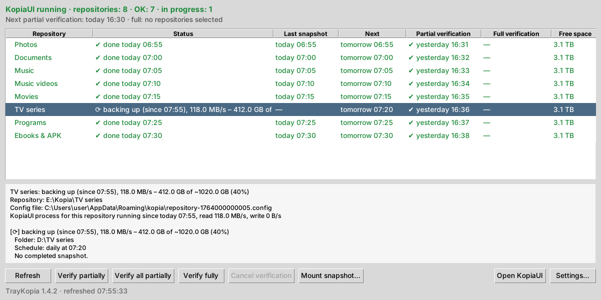
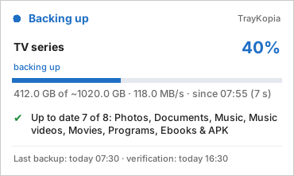
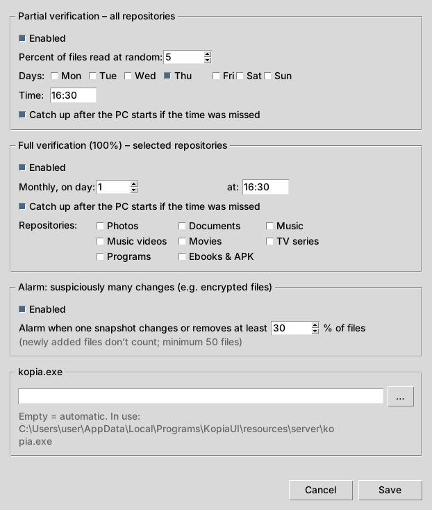

# TrayKopia

**Backup status of [Kopia](https://kopia.io) / KopiaUI in the Windows system tray.**

KopiaUI works great, but it doesn't show in the tray whether a backup is running, finished, or failed – and with several repositories you have to open each window separately. TrayKopia watches all your KopiaUI repositories and shows everything in one tray icon: what's done, what's running (with progress), and what needs attention.



## Features

- **One tray icon for all repositories** – green ✔ all up to date, animated ⟳ backup running, ✖ problem, ⏸ KopiaUI not running.
- **Live tooltip** – hover the icon to see progress (percent, speed, size), problems and the last backup time. It updates in place and stays open while the cursor is on the icon.
- **Zero configuration** – repositories, folders and schedules are read directly from KopiaUI and the repository policies. New repositories appear automatically. Portable KopiaUI is supported too.
- **Knows the schedule** – a backup is "done" when it ran after the most recently scheduled time, so a late schedule (e.g. 22:00) doesn't make the whole day red. It understands catch-up after the PC was off, *Ignore identical snapshots*, manual-only sources and failed snapshots (with the error message from KopiaUI's log).
- **Scheduled verification** – partial (`kopia snapshot verify`, e.g. 5% of files weekly) for all repositories and full (100%) monthly for the ones you choose. Results and history are shown per repository.
- **Suspicious-changes alarm** – warns when a snapshot changed or removed an unusual share of files (e.g. ransomware encryption). Newly added files don't count. Acknowledge with "It was me".
- **Mount any snapshot** – pick a snapshot and it opens in Explorer as a read-only drive.
- **Notifications** for new problems, low disk space on the repository drive and failed verification.
- **Self-diagnostics** – tells you if KopiaUI's logs stop matching (e.g. after a Kopia update changed log messages), so you know when details may be incomplete.
- **English / Polish**, start with Windows, single instance.

| Tooltip | Verification settings |
|---|---|
|  |  |

## Requirements

- Windows 10 / 11
- [KopiaUI](https://kopia.io/docs/installation/) (tested with Kopia **0.23**)
- To run from source: Python 3.10+ and `pip install -r requirements.txt`

## How it works

TrayKopia doesn't need any access to KopiaUI's internals or passwords:

- repositories are found in `%APPDATA%\kopia\*.config` (and next to a portable `KopiaUI.exe`),
- snapshots and policies are read with the `kopia.exe` bundled with KopiaUI (`snapshot list`, `policy show` – read-only, using the same saved credentials as KopiaUI),
- "backup running" and snapshot errors come from KopiaUI's server logs in `%LOCALAPPDATA%\kopia\cli-logs` and from process I/O activity,
- verification runs `kopia snapshot verify --verify-files-percent=N`,
- settings and history are stored in `%APPDATA%\TrayKopia`.

KopiaUI must be running for its scheduler to make backups – TrayKopia shows a clear warning when it isn't.

## Build (Nuitka)

Put `created.png` (banner) next to `traykopia.py`, then:

```
python -m nuitka --onefile --onefile-tempdir-spec="{CACHE_DIR}/{COMPANY}/{PRODUCT}/{VERSION}" --onefile-cache-mode=cached --windows-console-mode=disable --enable-plugin=tk-inter --include-module=pystray._win32 --include-data-files=created.png=created.png --include-data-files=traykopia.ico=traykopia.ico --windows-icon-from-ico=traykopia.ico --company-name=nyorbee --product-name=TrayKopia --file-version=1.5.1 --product-version=1.5.1 --file-description="TrayKopia - Kopia backup status" --output-filename=TrayKopia.exe traykopia.py
```

## Disclaimer

TrayKopia is an independent tool and is not affiliated with the Kopia project. It only reads repository information and never modifies your backups (except mounting snapshots read-only on request).

---

## 🇵🇱 Po polsku

**TrayKopia** pokazuje w zasobniku systemowym stan kopii zapasowych robionych przez Kopię / KopiaUI.

- jedna ikona dla wszystkich repozytoriów: ✔ wszystko aktualne, kręcąca się strzałka gdy robi się kopia, ✖ problem, ⏸ KopiaUI nie działa,
- dymek po najechaniu: postęp (procent, prędkość), problemy, ostatnia kopia, odświeżany na żywo,
- sama odczytuje repozytoria, foldery i harmonogramy z KopiaUI, nic nie trzeba konfigurować,
- okresowe sprawdzanie kopii (częściowe i pełne) z historią wyników,
- alarm przy podejrzanie dużej liczbie zmian (np. zaszyfrowanie plików przez ransomware),
- montowanie dowolnego snapshotu jako dysk tylko do odczytu,
- język angielski i polski (menu w zasobniku → *Language / Język*).

Wymagania: Windows 10/11 i KopiaUI (testowane z Kopią 0.23).

## License

MIT – see [LICENSE](LICENSE).

Created by **IT Guy** – [Facebook](https://www.facebook.com/ajtiguy) · [GitHub](https://github.com/nyorbee)
